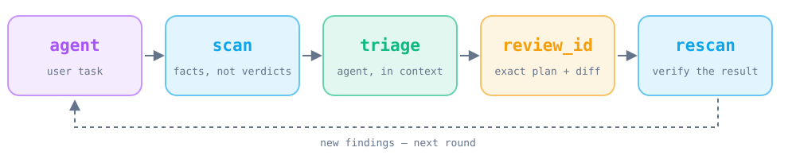
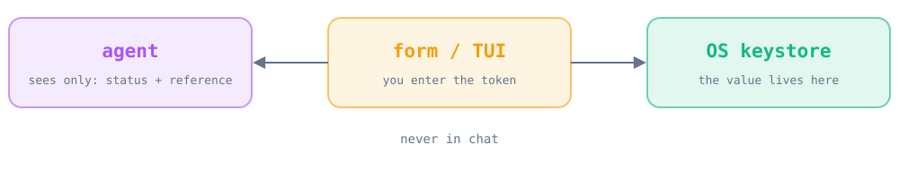

<p align="center">
  
</p>

<p align="center">
  <b>The security toolkit your coding agent works with: the agent thinks and edits, Guardkit supplies facts, reviewable plans and safe secret entry. All local.</b><br>
  <a href="README.md">Русский</a> · English
</p>

<p align="center">
  
  
  
  <a href="LICENSE"></a>
</p>

## Install

**Recommended: install through your coding agent.** Guardkit is designed for ongoing use with Claude Code, Codex, and Cursor. Your agent investigates findings, explains risks, and makes changes within the task; Guardkit provides repeatable local scans and constrained, reviewable fix plans. No bundled LLM or API key is required: your coding agent provides the intelligence.

Use the [installation prompt](README.md#установка) in the Russian README, or install manually below.

**Manually** (Linux, macOS, WSL):

```bash
git clone https://github.com/nejroseld/guardkit.git && cd guardkit
python3 -m venv .venv && .venv/bin/python -I -m pip install .
.venv/bin/guardkit init --root /path/to/project
.venv/bin/guardkit scan --root /path/to/project
```

> The repository is private for now — GitHub access required. The first run downloads scanners and databases.

## How it works

<p align="center"></p>

Guardkit does not try to replace the agent. It covers what an agent should not be taken on faith for: what exactly was found, what exactly will change, and where a secret went.

| | |
|---|---|
| 🧩 **Code** | dangerous patterns in Python, JS, TS (Semgrep) |
| 📦 **Dependencies** | known CVEs in packages (Trivy) |
| ⚙️ **Config** | Dockerfile, Kubernetes, Terraform (Trivy) |
| 🔑 **Secrets** | leaked keys and tokens, values never printed |

**Facts.** `guardkit scan --json` returns findings and honest exit codes: 0 means no findings, 1 means findings, 2 means the scan is incomplete (not "clean").

**Reviewable edits.** `guardkit fix --check --json` prepares constrained plans and a `review_id`. `guardkit fix --apply REVIEW_ID --json` applies only the plan that was already shown, then rescans. The agent makes other changes as ordinary edits and shows them to you. For fix, exit 0 means proposals were generated and 2 means the operation was incomplete.

**The agent connects itself.** `guardkit init` adds managed blocks to `AGENTS.md`/`CLAUDE.md`, skills for Codex and Claude Code, and a Cursor rule. The same set is exposed as an MCP server: `scan`, `findings`, `propose_safe_fixes`, `apply_safe_fixes`, `open_safe_input`.

## Secrets stay out of the chat

<p align="center"></p>

When the agent needs a token or login, it calls `open_safe_input`. You type the value into a masked form or TUI, it goes straight to the OS keystore, and the agent receives only status and a reference. In MCP Apps clients the form opens inline and values are encrypted before submission (AES-256-GCM, key wrapped with RSA-OAEP). See [Safe Input](docs/secrets.md#safe-input-for-agent-requests).

Build a local plugin for such a client with `guardkit plugin --root PROJECT --output OUTPUT`; see [setup](docs/safe-input-app.md).

## More

[Setup](docs/setup.md) · [Agents & MCP](docs/agents.md) · [Scanners](docs/scanners.md) · [Secrets](docs/secrets.md) · [Safe Input App](docs/safe-input-app.md) · [Validation](docs/validation.md) · [Audit](docs/security-audit.md)

<sub>MIT · Scanning does not guarantee the absence of all vulnerabilities.</sub>
