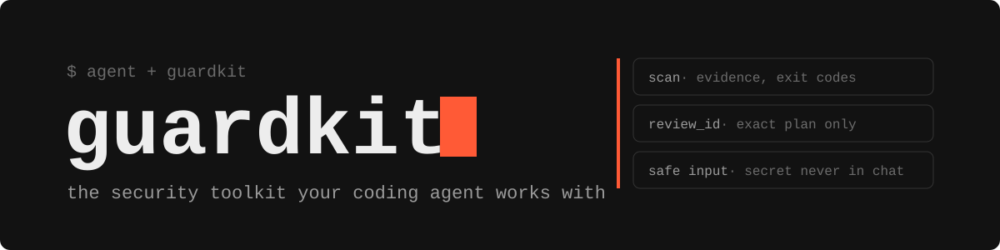

<p align="center">
  
</p>

<p align="center">
  <b>Local security checks for your project, built for Claude Code, Codex and Cursor.</b><br>
  <a href="README.md">Русский</a> · English
</p>

<p align="center">
  
  
  
  <a href="LICENSE"></a>
</p>

Guardkit finds vulnerabilities and leaked secrets. Your agent reviews the findings and fixes the code. No API key needed, everything runs locally.

## What it does

| What | How |
|---|---|
| 🧩 **Code** | finds dangerous patterns in Python, JS, TS (Semgrep) |
| 📦 **Dependencies** | finds known CVEs in packages (Trivy) |
| ⚙️ **Config** | checks Dockerfile, Kubernetes, Terraform (Trivy) |
| 🔑 **Leaked secrets** | finds keys and tokens in project files without printing values |
| 🧾 **One report** | merges findings from all scanners into one list with priority and code location |
| 🤖 **Agent** | plugs into Claude Code, Codex and Cursor via instructions and MCP; the agent reviews findings and applies reviewed fixes |

## Install

The easiest way is to give your agent the [installation prompt](README.md#установка) from the Russian README.

Or install manually (Linux, macOS, WSL):

```bash
git clone https://github.com/nejroseld/guardkit.git && cd guardkit
python3 -m venv .venv && .venv/bin/python -I -m pip install .
.venv/bin/guardkit init --root /path/to/project
.venv/bin/guardkit scan --root /path/to/project
```

The repository is private for now, so you need GitHub access. The first run downloads scanners and databases.

## Docs

[Setup](docs/setup.md) · [Agents & MCP](docs/agents.md) · [Scanners](docs/scanners.md) · [Validation](docs/validation.md) · [Audit](docs/security-audit.md)

<sub>MIT · Scanning does not guarantee that there are no vulnerabilities.</sub>
