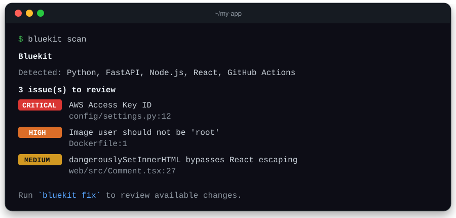
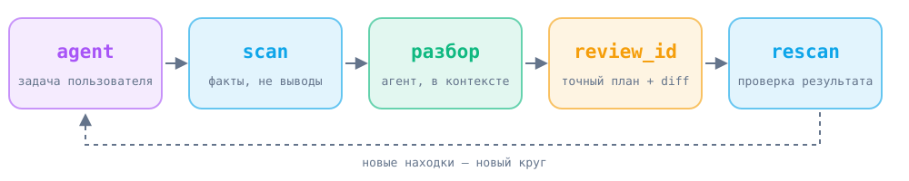

<p align="center">
  
</p>

<p align="center">
  <b>Проверка безопасности проекта одной командой — локально, без облака.</b><br>
  Русский · <a href="README.en.md">English</a>
</p>

<p align="center">
  
  
  
  <a href="LICENSE"></a>
</p>

<p align="center"></p>

## Установка

**Через агента.** Скопируйте промпт и отправьте Claude Code, Codex или Cursor — агент сам поставит Guardkit и проверит проект.

<details>
<summary><b>📋 Промпт для агента</b></summary>

```text
Установи Guardkit из https://github.com/nejroseld/guardkit для моего текущего проекта. Выполни установку сам, а не только опиши команды.

1. Определи корень текущего проекта и найди Python 3.10–3.14, совместимый с текущими сканерами. Клонируй Guardkit в отдельный каталог вне проверяемого проекта и создай для него отдельное виртуальное окружение. Не меняй зависимости проекта или системный Python.
2. Установи клонированный Guardkit Python-интерпретатором этого окружения через `python -I -m pip install <каталог Guardkit>`. Репозиторий пока приватный: используй уже настроенный доступ GitHub. Если доступа нет, сообщи, что нужен вход в GitHub; не запрашивай токены в чате.
3. Исполняемым файлом Guardkit из этого окружения выполни `guardkit init --root <корень проекта>`, затем `guardkit doctor --root <корень проекта> --json` и `guardkit scan --root <корень проекта> --json`. Существующие инструкции агентов сохраняй. Не применяй исправления и не запускай код или тесты проверяемого проекта без отдельного запроса.
4. Учитывай коды завершения scan: 0 — завершено без находок, 1 — найдены проблемы, 2 — проверка неполная. Не называй неполную проверку успешной. Не выводи значения секретов.
5. В конце укажи, куда установлен Guardkit, какой коммит установлен, результаты doctor и scan и точную команду для следующей проверки проекта.
```

</details>

**Вручную** (Linux, macOS, WSL):

```bash
git clone https://github.com/nejroseld/guardkit.git && cd guardkit
python3 -m venv .venv && .venv/bin/python -I -m pip install .
.venv/bin/guardkit init --root /путь/к/проекту
.venv/bin/guardkit scan --root /путь/к/проекту
```

> Репозиторий пока приватный — нужен доступ к GitHub. Первый запуск скачивает сканеры и базы.

## Как работает

<p align="center"></p>

| | |
|---|---|
| 🧩 **Код** | опасные конструкции в Python, JS, TS (Semgrep) |
| 📦 **Зависимости** | известные CVE в пакетах (Trivy) |
| ⚙️ **Конфигурация** | Dockerfile, Kubernetes, Terraform (Trivy) |
| 🔑 **Секреты** | забытые ключи и токены, без вывода значений |

`guardkit fix --check` покажет diff, `guardkit fix` применит его после подтверждения.

## Подробнее

[Установка](docs/setup.md) · [Агенты и MCP](docs/agents.md) · [Сканеры](docs/scanners.md) · [Секреты](docs/secrets.md) · [Проверки](docs/validation.md) · [Аудит](docs/security-audit.md)

<sub>MIT · Сканирование не гарантирует отсутствие всех уязвимостей.</sub>
