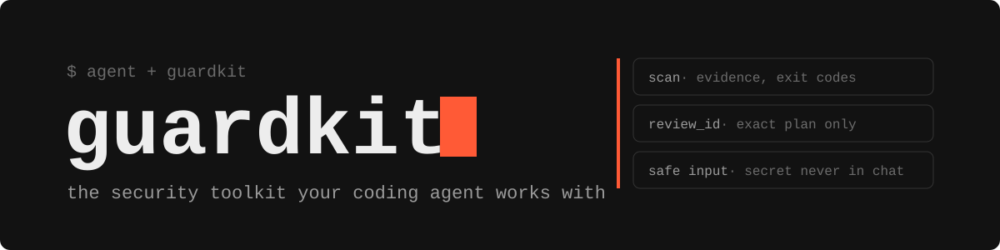
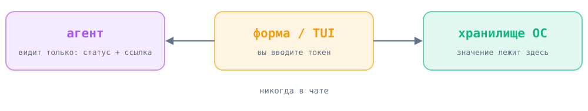

<p align="center">
  
</p>

<p align="center">
  <b>Security toolkit, с которым работает ваш coding agent: агент думает и правит, Guardkit даёт факты, проверяемые планы и безопасный ввод секретов. Всё локально.</b><br>
  Русский · <a href="README.en.md">English</a>
</p>

<p align="center">
  
  
  
  <a href="LICENSE"></a>
</p>

## Установка

**Рекомендуемый способ — через coding agent.** Guardkit рассчитан на совместную работу с Claude Code, Codex и Cursor. Агент ведёт анализ, объясняет находки и исправляет их в рамках задачи; локальные инструменты Guardkit дают ему воспроизводимые сканы и ограниченные, проверяемые планы исправлений. Встроенная LLM или API-ключ не нужны: интеллект предоставляет ваш coding agent.

<details>
<summary><b>📋 Промпт для агента</b></summary>

```text
Установи Guardkit из https://github.com/nejroseld/guardkit для моего текущего проекта и используй его как постоянный security toolkit в своей работе. Выполни установку и первичный анализ сам.

1. Определи корень текущего проекта и найди Python 3.10–3.14, совместимый с текущими сканерами. Клонируй Guardkit в отдельный каталог вне проверяемого проекта и создай для него отдельное виртуальное окружение. Не меняй зависимости проекта или системный Python.
2. Установи клонированный Guardkit Python-интерпретатором этого окружения через `python -I -m pip install <каталог Guardkit>`. Репозиторий пока приватный: используй уже настроенный доступ GitHub. Если доступа нет, сообщи, что нужен вход в GitHub; не запрашивай токены в чате.
3. Запусти установленный Guardkit абсолютным путём, с изолированным Python и явным корнем проекта: `<venv>/bin/python -I -m guardkit init --root <корень проекта>`. Инициализация добавляет управляемые блоки в AGENTS.md/CLAUDE.md, skills для Codex/Claude Code и правило Cursor с `alwaysApply: true`; сохрани пользовательский текст и покажи, что было добавлено или безопасно обновлено. Не перезаписывай пользовательские инструкции.
4. Тем же абсолютным интерпретатором выполни `<venv>/bin/python -I -m guardkit doctor --root <корень проекта> --json` и `<venv>/bin/python -I -m guardkit scan --root <корень проекта> --json`. Используй результаты для анализа проекта: проверь находки в их контексте, объясни риск и предложи исправления в рамках запроса пользователя. Перед изменениями покажи конкретный план и diff; применяй в пределах разрешённой пользователем задачи. Для Guardkit-планов сначала получи `<venv>/bin/python -I -m guardkit fix --check --root <корень проекта> --json`, затем передай выданный `review_id` в `<venv>/bin/python -I -m guardkit fix --apply REVIEW_ID --root <корень проекта> --json` — применится только просмотренный вариант, после чего скан запускается повторно.
5. Не запускай код проекта или тесты автоматически. Если тесты явно входят в задачу, запускай их только вместе с применением Guardkit-плана: `<venv>/bin/python -I -m guardkit fix --apply REVIEW_ID --run-tests --root <корень проекта> --json`.
6. Учитывай коды завершения: 0 — завершено без находок, 1 — найдены проблемы, 2 — проверка неполная. Не называй неполную проверку успешной. Не выводи значения секретов.
7. В конце укажи, куда установлен Guardkit, какой коммит установлен, результаты doctor и scan, внесённые изменения и точную команду для следующей проверки проекта.
```

</details>

**Вручную** (Linux, macOS, WSL):

```bash
git clone https://github.com/nejroseld/guardkit.git && cd guardkit
python3 -m venv .venv && .venv/bin/python -I -m pip install .
.venv/bin/guardkit init --root /путь/к/проекту
.venv/bin/guardkit scan --root /путь/к/проекту
```

> Репозиторий пока приватный — нужен доступ к GitHub. Первый запуск скачивает сканеры и базы.

## Как работает

<p align="center"></p>

Guardkit не пытается заменить агента. Он закрывает то, что агенту нельзя доверять на слово: что именно найдено, что именно будет изменено и куда попал секрет.

| | |
|---|---|
| 🧩 **Код** | опасные конструкции в Python, JS, TS (Semgrep) |
| 📦 **Зависимости** | известные CVE в пакетах (Trivy) |
| ⚙️ **Конфигурация** | Dockerfile, Kubernetes, Terraform (Trivy) |
| 🔑 **Секреты** | забытые ключи и токены, без вывода значений |

**Факты.** `guardkit scan --json` отдаёт находки и честные коды выхода: 0 — без находок, 1 — есть проблемы, 2 — проверка неполная (это не «чисто»).

**Проверяемые правки.** `guardkit fix --check --json` готовит ограниченные планы и `review_id`. `guardkit fix --apply REVIEW_ID --json` применяет только тот план, который вы или агент уже видели, и сразу пересканирует проект. Остальное агент правит как обычные изменения и показывает вам. Для fix код 0 значит «предложения готовы», 2 — операция неполная.

**Агент подключается сам.** `guardkit init` добавляет управляемые блоки в `AGENTS.md`/`CLAUDE.md`, skills для Codex и Claude Code и правило Cursor. Тот же набор доступен как MCP-сервер: `scan`, `findings`, `propose_safe_fixes`, `apply_safe_fixes`, `open_safe_input`.

## Секреты не попадают в чат

<p align="center"></p>

Когда агенту нужен токен или логин, он вызывает `open_safe_input`. Вы вводите значение в маскированной форме или TUI, оно сразу уходит в системное хранилище, а агент получает статус и ссылку. В клиентах с MCP Apps форма открывается прямо в диалоге, значения шифруются до отправки (AES-256-GCM, ключ обёрнут RSA-OAEP). Подробнее: [Safe Input](docs/secrets.md#safe-input-for-agent-requests).

Локальный плагин для такого клиента собирается так: `guardkit plugin --root PROJECT --output OUTPUT`, см. [подключение](docs/safe-input-app.md).

## Подробнее

[Установка](docs/setup.md) · [Агенты и MCP](docs/agents.md) · [Сканеры](docs/scanners.md) · [Секреты](docs/secrets.md) · [Safe Input App](docs/safe-input-app.md) · [Проверки](docs/validation.md) · [Аудит](docs/security-audit.md)

<sub>MIT · Сканирование не гарантирует отсутствие всех уязвимостей.</sub>
